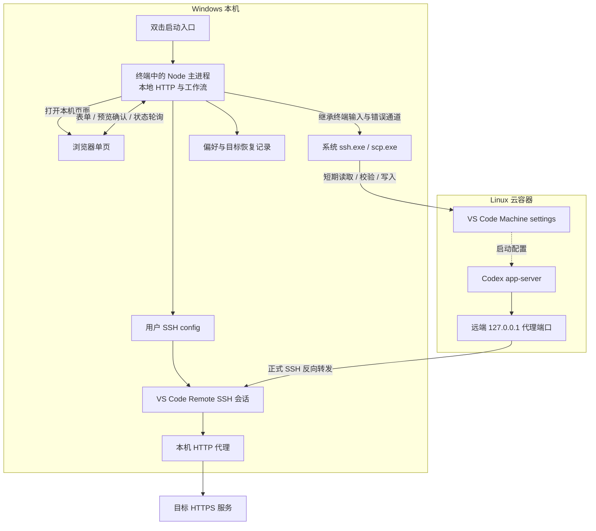

# v0.3 技术架构：本地网页与云容器初始化

> 日期：2026-10-22。状态：实施设计，新增能力尚未实现或实测。
> 需求依据：[v0.3 PRD](PRD_V0.3.md)，含同日确认的轻量本地网页。
> 安全依据：[SECURITY.md](../SECURITY.md)。已有实现：[CLI](../scripts/e2e.mjs)、[传输](../scripts/ssh.mjs)、[配置编辑](../scripts/config.mjs)。
> 本文替代 v0.2 插件架构作为新版实施方向；历史验收只能证明 v0.1 路径，不能证明本设计已经可交付。
> 评审修订：实现约定遵循 PRD 2.3 的 D01–D08；八项推荐方案已确认，具体版本与运行证据仍待实施验证。
> 执行规格：[v0.3 Spec](SPEC_V0.3.md)。第 8.2 节细化每次远端动作的 writeId、私有暂存许可与提交互斥，须经受控验证后接真实配置；任务与验收状态以 Spec 执行记录和实际证据为准。

## 1. 架构决策

采用 **一个在 Windows 原生终端中运行的 Node.js 进程，同时承载本地 HTTP 入口和初始化工作流**。浏览器负责输入、进度与确认，OpenSSH 在该终端中直接认证，VS Code Remote SSH 承担正式会话及持续代理转发。

| 部分 | 选择 | 原因 |
| --- | --- | --- |
| 页面 | 随包 HTML、CSS、原生 JavaScript，单页，无构建步骤 | 当前只有表单、步骤列表和操作确认，无需前端框架 |
| 本地 HTTP | Node 内置 `http`，只绑定 IPv4 回环随机端口 | 复用已有运行时，不增加 Web 框架 |
| 页面进度 | 当前状态快照，操作期间约一秒轮询 | 无需 WebSocket、事件总线或持久日志平台 |
| 工作流 | 同进程异步函数，同一用户数据目录单工作实例、实例内单操作 | 等待认证或用户动作时仍保有操作归属，避免新增执行进程及跨窗口同步 |
| SSH / SCP | 复用系统 OpenSSH 和现有终端继承方式 | 密码不进入网页或工具输入处理代码 |
| 配置 | 复用 JSONC 局部编辑、摘要、原子替换与最小逆操作 | 保留现有保护措施 |
| 分发 | Windows ZIP，随包 Node 运行时、现有依赖及启动入口 | 用户无需安装 Node 或运行 npm |

不引入 Electron、Tauri、专用 VS Code 扩展、数据库或远端常驻进程。取消、原生认证和打包组合仍需实测，不能凭 Node 提供相关能力就认定交付成立。

## 2. 结构与请求路径



网页不接触 SSH stdout 中的完整设置文件；工作流只投影必要状态给页面。工作流的检查连接关闭转发与复用，不承担正式流量。工具退出不会主动结束用户的 VS Code 会话；该会话退出后转发是否存在按真实连接判断。

## 3. 仓库事实与改造边界

| 当前实现事实 | 本版处理 |
| --- | --- |
| `runCommand` 支持注入 `io` 和 `dependencies`，结果主要是文本及退出码 | 提取确实共享的工作流；补结构化预览、结果与阶段通知，不让页面解析中文输出 |
| `runInteractiveProcess` 要求 stdin、stderr 为 TTY，SSH stdout 可单独捕获 | Node 主进程留在可见原生终端，保持 TTY；页面确认等待不占用 stdin |
| `preflightRemote` 同时检查 Linux 工具与已安装 Codex 扩展 | 拆为基础环境检查和扩展行为检查，避免初始化前要求 Codex 已安装 |
| `inspectTarget` 等内部函数默认直接调用模块函数 | 仅在进度、取消等确有需要处传递依赖；不声称顶层注入自动覆盖嵌套调用 |
| SSH 编辑器要求唯一工具标记，不能管理多个目标片段 | 新目标使用含 targetId 的标记；兼容旧标记，完整扫描未知占用与重复标记 |
| 本地原子写入要求目标文件已存在 | SSH config 缺失时增加受限的新建路径，不能用空文件覆盖未知状态或链接 |
| `active.json` 是单活动恢复记录，支持旧版本转换 | 增加目标记录存储及显式旧记录迁移，保留同一全局锁位置 |
| 恢复保护依赖整文件摘要 | 保持保守保护；跨目标不尝试自动合并，冲突时保留旧内容并用新 alias 继续 |
| `remove` / `restoreState` 默认两端恢复信息均已存在 | 按资源是否触及分支处理；远端未触及时不调用 `remoteRead`，也不要求 settings 路径 |

以上基于本次读取的代码。不得把 v0.1 的 `configure` 原样包进按钮就称为新容器初始化：它的前提和事务顺序均需局部调整。

## 4. 启动、页面与原生认证

### 4.1 启动与打包

候选 ZIP 包包含固定 `start.cmd`、`runtime/node.exe`、应用脚本、静态页面、`jsonc-parser` 及许可证。启动入口用固定的相对路径定位运行时与主脚本，不拼接用户参数，不要求 PATH 中存在 Node，不使用 PowerShell `Bypass`。

主进程启动时核对 Windows、TTY 和包内资源，监听 `127.0.0.1:0`，取得系统分配端口后打开默认浏览器。浏览器启动器只接收程序自己生成的回环 URL，不能成为任意命令执行接口。中文、空格和特殊字符目录必须实装验证。

若浏览器未自动打开，终端提供本次访问地址；不要求用户启动本地开发服务器。监听和开始业务前先取得同一数据目录的工作实例锁；第二次双击仅在启动终端提示使用原窗口并退出，不启动第二个工作流或自动接管旧实例。不建设跨实例窗口同步或转发令牌的发现服务。

运行时选择满足项目最低版本的受支持 Windows Node LTS，发布时固定精确版本、校验值及架构，不直接把开发机上找到的任意 node.exe 打入包；先验证 Windows x64 样本，不宣称其他架构兼容。

### 4.2 页面职责

页面只保留连接与代理表单、当前目标、步骤进度、检查结果、变更预览和必要按钮。输出包含 `step`、`status`、`message`、`nextAction`、检查时间及字段错误；不用未经测量的百分比伪装完成进度。

刷新只读取状态，不重发操作。配置摘要、完整配置、SSH 原始错误和恢复逆操作不作为页面状态字段返回。表单和错误用文本渲染，禁用把用户内容作为 HTML 注入。

### 4.3 认证方式

主进程直接调用现有 `runSsh` / `runScp`，其子进程保持 `shell:false` 和参数数组，stdin、stderr 继承启动终端；stdout 仍仅由工作流内存解析。浏览器显示“请切换到启动终端完成认证”，不读取终端按键、不转发密码、不录制 stderr。

原生主机密钥确认也留在终端。主进程不创建 readline 密码问答；页面参数收集和业务确认通过 HTTP 返回 Promise 的结果，不与 OpenSSH 竞争 stdin。不采用伪终端、AskPass 或 PowerShell 密码桥接。

当前传输中的中文进度增加可选通知回调；默认 CLI 继续打印原文，网页模式只接收白名单事件，不能全局替换 console 捕获任意输出。Node 的终端继承能力见 [官方子进程文档](https://nodejs.org/api/child_process.html)，实际 Windows 组合须验证。

## 5. 本地 HTTP 接口与操作语义

### 5.1 接口草案

| 接口 | 用途 | 约束 |
| --- | --- | --- |
| `GET /api/state` | 当前操作、必要目标摘要、偏好、待确认预览 | 无 SSH 和写文件副作用，不返回完整恢复记录 |
| `POST /api/preferences` | 保存已确认的非秘密偏好 | 严格字段校验，独立于目标配置确认 |
| `POST /api/operations` | 开始 `initialize / resume / verify / remove / abandon` | 固定枚举和经过校验的输入，返回 operationId，耗时工作异步执行 |
| `POST /api/operations/:id/answer` | 回答具体预览或人工步骤提示 | 校验 questionId、revision、选择枚举，不接受任意代码或命令 |
| `POST /api/operations/:id/cancel` | 请求安全取消 | 先进入 cancelling，完成清理后才报告 cancelled 或 recovery-required |
| `POST /api/shutdown` | 退出工具 | 活动操作需先取消与收尾，不立即杀进程 |

同一进程仅一个操作可运行，包括 verify 和归档；重复提交的 requestId 返回原 operationId，不新建第二次工作。requestId 与请求摘要绑定，同 id 不同内容拒绝；该去重只覆盖本次进程，重启后的继续由持久事务与真实状态决定。

`initialize` 输入必须声明 `new-or-rebuilt`，总是创建新 targetId；`resume / verify / remove / abandon` 绑定明确的 targetId 与生命周期 revision，不由同地址自动推导。每次从人工等待返回、每个外部操作及恢复开始前再次核对记录身份、revision 和允许状态；过期回答不能推进新目标。设置偏好不改变当前目标参数；本版不提供带旧逆操作的原地换端口，先移除原代理再新建确认计划。

旧记录或唯一未完成切换的核对也经过共享 `runOperation`：`resume` 的互斥输入 `stateRecovery: { expectedEntryHash }`（无入口为 null），不携带目标/连接参数。确认后再核对入口及全部候选来源，只收敛元数据，不发 SSH、不重放配置；核对结束后由用户重新选择业务动作，页面刷新仅 GET。

同一时刻只管理一个当前目标；已有目标时，新建入口先完成经确认的弃用/归档，再建立新目标，不让 `initialize` 绕过旧目标处理。已移除代理的目标可重新配置，但必须在显式确认后建立新的代理写入周期与恢复基线，保留旧周期结果，不把已撤销字段自动重放。弃用后的目标只读保存，不自动重新激活。

业务预览由工作流生成普通对象：目标、文件路径、允许的字段或片段增量、影响范围、revision。确认只绑定此预览；取得全局锁后重新核对记录和文件摘要，计划变化即失效，重新预览。网页确认不替代锁后复核。

### 5.2 回环接口保护

本地 HTTP 可以触发文件修改，不能只凭“绑定回环”开放给任意网站。

- 只接受启动时确定的 `127.0.0.1:<port>` Host，关闭 CORS，不监听局域网或公网；所有数据和操作接口要求本次随机会话令牌。
- 启动 URL 用 fragment 交付令牌，页面读入内存及当前标签页的 sessionStorage 后立即从地址栏历史移除；不放 query、cookie、持久 localStorage 或日志。重启生成新令牌。
- 页面请求使用自定义令牌请求头；写入接口还要求同源 Origin、JSON 内容类型及有限请求体。令牌校验与 Host 校验同样作用于状态读取；拒绝跨站预检和跨站请求，不用 GET 触发任何修改。
- 静态资源固定白名单，无任意本地文件读取、文件浏览或命令执行接口；路径输入只用于已定义配置职责。
- 页面资源全部随包，不用 CDN；设置禁止外部脚本、禁止被嵌入、仅同源连接的 CSP，以及 no-store 和不发送 Referrer 的策略。
- 令牌不等于 SSH 凭证。该方案信任当前本机用户，不宣称防御同用户恶意进程；令牌泄漏立即退出并重启会话。

## 6. 初始化顺序与首次联网

### 6.1 分阶段事务

将流程拆成可检查的阶段，不把所有动作伪装成跨机原子事务：

1. **只读输入与预检**：解析连接字段，检测本地代理与工具；尚无 alias 时，以参数数组直接连接明确地址，只执行固定基础探测。检查 Linux 工具、用户和端口，不检查 Codex 安装。
2. **本机连接与转发**：生成未占用的新 alias 或复用已核对目标；一次预览分别列出连接信息和转发增量。确认后持写入锁，先保存意图并写连接块、核对 `ssh -G` 的地址/用户/端口等预期有效值；再以完成的连接块为基线，单独记录并应用转发，允许的额外差异只有获准转发。前一子步骤成功、后一子步骤失败时保留连接。
3. **VS Code Server 准备**：通过公开入口打开目标连接，必要时引导用户从 Remote SSH 列表选择；不能用进程启动退出码认定远端服务端已安装。
4. **远端路径与代理设置**：服务端安装有依据后识别 Machine settings，展示来源与精确增量，确认后保存逆操作、局部写入并复读。该步骤不依赖 Codex 已安装。
5. **Codex 准备**：实际修改 settings 或本次新增转发后，引导保存工作并重连使代理设置生效；等价 settings 且本次转发未变时省去该等待，仍独立检查生效结果。复用预览展示目标字段并说明没有删除所有权。使用官方远端扩展入口安装或复用 Codex，随后检查实际包版本及代理启动行为。
6. **运行检查**：需要时再次重连，打开 Codex 并由用户登录；独立检查五层结果，再进行用户真实请求及有限只读归因。

维护者采集实现见[只读采集说明](PROXY_OBSERVATION_V0.3.md)：退出产品后独占同一实例锁，先结束自动探测，再按有限窗口核对目标进程身份及 socket 所有权。只有目标 PID 持有的、窗口中新建至指定回环代理的 ESTABLISHED 连接形成连接证据；新回复另记，已有长连接或证据不足保留未知。此工具不写配置、不读凭证、不发模型请求，不随用户包交付，也不形成第二套业务恢复逻辑；真实采集仍待验证。

PRD 4.2 已同步该顺序：先落地远端代理再安装 Codex，避免安装依赖 Codex 已运行；该顺序不代表远端代理设置已证明能覆盖整个安装网络。已安装且兼容的扩展可复用，不扩大配置字段。

每个写入阶段都保留原始意图、摘要与实际结果。后续安装、登录和检查失败标为“初始化未完成”，保留此前成功阶段，提供继续或移除；某次配置写入失败只恢复该未完成步骤的已知变更。取消采用同一保留原则，不自动撤销整次初始化。移除不卸载软件。

### 6.2 阶段记录与恢复规则

不用一个总 `phase` 代替各资源事实。目标记录中分别保存连接、转发、settings 的 `untouched / intended / applied / reused / reverted / unknown` 状态；阶段进度、操作运行状态和实时检查结果分开。settings 为 `untouched` 时允许没有路径、摘要和逆操作，禁止构造空的远端恢复项再调用旧恢复函数。

每个写入步骤在任何真实写入前，持原写入锁保存并核对 operationId、目标 revision、文件存在性、before/after 摘要及最小逆操作；正式写入后复读并保存结果，之后才能推进下一步。首次配置的归属/恢复基线与本次待执行动作分开存储：动作注明 apply/restore/cleanup、执行前状态和预期结果，移除或重试不能覆盖首次恢复依据。元数据持久化失败则停止推进；下次从已保存意图和真实状态核对。等价值记为 `reused`，没有删除所有权。

| 资源/阶段事实 | 继续及当前失败的处理 | 正常移除 |
| --- | --- | --- |
| 全部 `untouched` | 只读预检；重试前重查前提 | 无配置可移除 |
| 连接 `applied/reused`，转发和 settings 未触及 | 保留连接；转发写入失败只恢复本次转发子步骤 | 保留连接；无需 SSH |
| 转发 `applied/reused`，settings 未触及 | 安装失败可重试；不要求已有 Codex 或 settings | 仅删除工具拥有的转发；无需 SSH |
| settings `intended/unknown` | 先确认旧写入已结束，再按下文核对；不并行重试 | 状态未确认不报告完成，不丢弃恢复依据 |
| settings `applied/reused`，后续安装/检查失败 | 保留两处配置，继续前重查版本、会话和网络 | 先恢复工具拥有的远端字段，再撤销工具转发，保留连接 |
| 代理均 `reverted` 或从未取得所有权 | 不自动回放原计划；重新配置须重新确认 | 记录已移除，保留必要来源和连接清理依据 |

对 `intended/unknown` 的资源，仅在原写入已结束后核对本次动作的 before/after：真实状态等于 after 且与计划一致时，按动作收敛为已应用、已恢复或已清理；等于 before 时，记本次动作未生效并保留执行前资源状态；两者均不等时冻结该资源并显示冲突。收敛仅补记事实，不再次运行原写入脚本。文件原本不存在用独立存在性标记表示；只对工具创建且仍无额外内容的文件提供删除，不删用户已有空文件或猜测目录。

**连接与代理的恢复基线分离（D01）：** 新连接记录其原始局部增量和前后摘要；转发的 beforeHash 必须包含已完成的连接块。删除转发后得到“保留连接、没有工具代理”的状态，不能回退到新连接建立前。settings 仍保留首次字段恢复依据。新建连接与转发使用可分别识别的归属标记，旧版标记只拥有原转发，不推导其拥有 Host 块。

正常 `remove` 保留连接和目标的清理依据，不删除 v3 入口，也不将已移除状态误作待继续初始化。若远端曾修改且当前不可达，普通移除保留需要恢复状态；用户可另选弃用并单独确认本机清理，远端结果保持未知。任一移除步骤中断，都记录该资源的移除意图/结果并按同样规则核对，不重新要求已经移除的资源仍等于原 afterHash。

### 6.3 下载依赖与公开入口

[Remote SSH 文档](https://code.visualstudio.com/docs/remote/ssh#_common-questions)说明 VS Code Server 可在本机下载并传至远端。先验证默认官方回退能否在标准样本成立；若需更改 `remote.SSH.localServerDownload`，必须先另行调整 PRD 的配置白名单并展示增量，不能作为隐藏写入。

扩展由用户在目标远端窗口的 VS Code 商店安装；工具只展示目标、候选版本与步骤，等待用户完成后检查实际远端版本、Linux 架构及运行位置。本机安装不能作为远端已安装的证据，不复制 Windows 扩展目录。

新版从标准 extensions.json 的唯一有效注册记录取得 Codex 包名，核对平台、相对目录和 file location；卸载残留目录不算有效候选。固定静态探测和实际进程检查沿用同一包与注册表摘要，期间变化拒绝通过。注册/调用链异常与缺少安装分别报告，界面启动故障不导向盲目重装。内部候选为 26.1021.22027，实际后端 0.164.0-alpha.11.1；仍待完整验收，不改变自动更新设置。

2026-10-24 按用户决定简化 D06：不实现插件下载器、自动安装、VSIX 回退及安装包暂存。商店访问失败时保留已完成配置，用户处理商店访问后继续。固定 Node 运行时仍由维护者校验并打进工具包，用户无需自行安装开发运行时。

| 必须单独验证的路径 | 执行位置与代理来源 | 成功依据与回退 |
| --- | --- | --- |
| VS Code Server 下载与传输 | Remote SSH 实际下载位置及其网络配置；回退为官方本机下载/传输 | 目标服务端实际安装且能运行；本机 curl 成功不能代替 VS Code 成功 |
| Codex 商店安装 | 用户在目标远端窗口使用 VS Code 商店 | 对应远端目录的实际版本/架构及加载位置；失败保留进度，不由工具下载回退 |
| Codex 请求 | 目标 app-server 的代理环境与 VS Code 会话提供的转发 | 五层检查、用户新回复及目标进程代理连接关联；不拿安装成功代替 |

三条路径需在干净容器分别验证，写清各端所需网络、必要点击及阻塞条件。用户已有设置导致 Remote SSH 准备失败时停止说明，不擅自覆盖；不以工具 curl 能联网补证商店安装成功。

商店不可用时报告具体阻塞；全新容器验收保留工具引导与用户商店安装步骤，不把扩展已预装作为隐藏前提。不依赖旧容器或其中的凭证，不要求拼接安装命令。

### 6.4 路径与进程归属

标准样本通过有限只读探测，将当前 SSH 用户、运行的 VS Code Server 安装及其 user data 目录相互关联后，定位 `Machine/settings.json`。仅看到惯用路径存在，不足以成为写入依据。

父目录归属与安装依据成立时允许创建缺失 settings 文件；不创建猜测的服务端目录。自定义安装或多候选显示必要来源并引导打开 Remote Settings 确认，仍不明确则停止。

Codex 进程筛选沿用用户、可执行文件和独立 app-server 参数校验。多候选时引导用户保留目标会话重查；不能任选第一个。版本行为不再符合旧代理启动路径时返回不支持或证据不足，不自动改用全局环境变量或包装可执行文件。

### 6.5 版本基线（D08）

在编排实现前选定候选标准组合，并在交付前固化精确 VS Code、Remote SSH、Codex 扩展及实际后端版本、Windows/OpenSSH/随包 Node、Linux 发行版/架构/基础库和必要工具、SCP/SFTP 能力。样本选择及后续证据写入脱敏验收记录，历史 E2E 只作候选参考，不伪造新组合已通过。

新安装优先使用已验证版本的官方获取和安装路径；Server 必须与实际 VS Code 对应，不独立强装其他版本。已有 Codex 或自动更新后的包重新核对，兼容则复用，不兼容则停止并保留进度；需要替换现有版本须另行说明并取得安装确认。本工具不修改用户自动更新设置，不静默降级。不支持把“最新版”作为固定基线；已验证版本不可获取时，先验证替代组合并更新交付基线再发布。

## 7. 数据、目标替换与旧版兼容

### 7.1 持久存储

继续使用 `%LOCALAPPDATA%/codex-remote-ssh-proxy-e2e/`，保持当前用户访问限制。拟议布局：

```text
preferences.json             非秘密本机偏好
active.json                  v3 入口、当前 targetId、入口 revision 与最后切换标识；阻止旧 CLI 误写
targets/<targetId>.json       生命周期、资源状态、归属、恢复信息与入口切换意图
instance.lock                网页/新版 CLI 共用的工作实例锁，持有至全部收尾结束
operation.lock               与 v0.1 相同位置的全局写入锁
```

targetId 是本机随机生成的不可复用标识，不是 alias、IP 或容器真实性证明。每个目标包含用户的生命周期声明、连接元数据、可得的非秘密身份依据、settings 路径及依据、生命周期状态、资源状态、各步骤结果和必要恢复信息；不持久保存完整配置和环境。目标 revision 与入口 revision 各自递增，不能比较二者数值相等来证明一致。实时检查单列时间与结果，重启后只作历史信息。

active.json 和目标记录分别采用同目录临时文件、持久化及原子替换。新建、弃用、迁移等入口切换在写入锁内，先在目标记录保存 transitionId、切换种类、预期入口摘要/revision、原/新 targetId、必要来源摘要、已确认计划的 revision 及切换意图，再切换入口；入口记 lastTransitionId，最后可补记完成。全部核对成功后才释放锁及执行后续目标写入。普通阶段更新不切换入口；不引入数据库或通用事务框架。

**启动恢复（D07）：** 取得工作实例锁后只读枚举固定 targets 目录与入口，校验文件类型、schema、记录归属与切换链；核对期间不运行目标写入。已完成切换的归档记录不属于待激活的孤立候选；不重放已完成的历史切换。出现损坏、未知版本、多候选或来源变化，不覆盖任意一份记录。

| 观察到的状态 | 允许动作 |
| --- | --- |
| 入口与完整目标一致，切换已完成 | 展示历史进度，等待用户明确选择继续；真实状态仍须重查 |
| 仅一份完整且已经用户确认的待切换记录，预期旧入口摘要仍吻合，切换链完整且无竞争候选 | 锁后复核，可自动完成同一入口切换并显示说明；仅修改元数据 |
| 入口已切换但目标完成标志未补记 | lastTransitionId 与目标意图唯一匹配才补记元数据 |
| 入口/目标损坏、多个孤立候选、旧迁移来源摘要变化或切换链不吻合 | 冻结受影响操作；页面列出脱敏目标、冲突原因和只读核对、保留并弃用的选择，不要求手改 JSON |
| 存在配置写入意图但结果未知 | 按第 6.2 节先确认原写入已结束，再核对目标资源；不能因指针修好而重放写入 |

有歧义时不按文件时间选最新。保留并弃用也须明确选择保留的候选、保存全部原始恢复依据、确认本机资源稳定且不存在仍在工作的原实例；不执行有歧义的逆操作。损坏文件无法安全解释时，仅允许只读说明与受控恢复指引，不承诺所有损坏都能自动继续。

实现补充：本机资源核对器可在独占实例下保存 `lastOutcome.localWriterClosed`，仅表示已完成本机读取且原本机写入已结束；有 pendingWrite 时必须对应同一 writeId。该证据完整且用户明确确认全部保留时，允许带冲突归档，本机文件/暂存不清理。未取得证据仍禁止弃用。旧远端 unknown 缺少可关闭许可时，不能由旧 phase 推导可恢复；页面明确提示可弃用并保留远端，旧自动移除仍待额外证明。

### 7.2 弃用 A、初始化 B

1. 用户确认弃用 A，保存弃用计划并标为 abandoning，保留当前入口与全部恢复信息；记录远端清理为已确认或未知。该操作不要求连接 A，也不能声称 A 远端已经恢复。
2. 可选本机清理先展示 A 的已知代理增量，再单独询问是否清理工具新建的连接块。先撤销本机代理再基于剩余连接的摘要清理；旧用户连接不删除。原文件由工具创建时，只有剩余内容仍完全属于工具且没有其他内容才可删除文件，不删目录。冲突则保留，不整文件回滚。
3. 用户选择保留或本机清理已结束后，按入口切换协议完成 A 归档并清空当前指针。中断时保留 abandoning 与各资源事实，只继续核对/弃用，不自动重新初始化 A。
4. 为 B 创建新 targetId，默认新 alias 和带该 targetId 的标记。用户要复用旧 alias 时，先安全解决旧块冲突；无法解决就保留并用新 alias。B 只复用本机偏好，重新探测自己的用户、路径、端口和进程，不沿用 A 的远端逆操作。

弃用流程中在 B 写入前提供一次 A 的可选本机清理；归档完成后不提供历史清理快捷按钮。在 A 写入后再新增 B，会改变整份 SSH config 摘要，因此后续不按 A 的旧摘要自动清理。保留记录与残留说明，用户可不清理并用新 alias 完成 B，无需手工编辑才能继续。B 的转发移除基线包含 A 残留及 B 自己的连接块。该保守方案避免跨目标配置合并器。

**生命周期选择（D04）：** 新建/重建无条件使用新 targetId，只将旧记录用于归档及可证明的本机清理，不把旧远端路径/逆操作带入新目标。继续原容器必须显式声明，之后核对记录、用户、实际路径、配置和可取得的主机密钥依据；任何不一致停止，不自动重置基线。相同摘要只证明内容相同，不证明容器身份。首版不写远端身份标记，不承诺识别误声明且线索完全相同的克隆。

主机密钥变化由 OpenSSH 阻断，不能借新 alias、HostKeyAlias、禁用检查或自动删除 known_hosts 继续。页面给出可信平台指纹核实与 OpenSSH/VS Code 官方处理指引，用户完成异常处理后重新检查；工具不解析未捕获 stderr 来声称指纹已确认。必要的用户命令/文件处理记录为安全异常，不纳入标准路径零手工操作的承诺。

弃用不要求连接 A。即使远端清理未知，也须确认本机旧子进程已结束、写入状态稳定且旧流程不会再推进；未知本机写入先本机核对。旧远端未知状态保留归档，不自动重试，也不在 B 的同名路径探测 A 的状态。

### 7.3 迁移与并发

首次遇到 v1/v2 active.json 时，先只读识别并展示旧目标；确认迁移后持原全局锁，将原必要恢复字段保存到新目标记录，核对成功后才原子切换 v3 入口。中断仍能从旧入口或已写新记录核对，不删除原恢复依据，不因远端失联强行判已移除。

v3 初始化后保留 v3 active.json，即使当前无目标也不删除该入口。首次无旧记录时，在任何目标配置写入前持原写入锁建立 v3 入口；有旧记录先完成上述迁移。持锁时再次核对旧记录，避免旧 CLI 在预览等待中已改变来源。旧 CLI 已在运行则先等待其释放写入锁或报告忙，不绕锁推进。

当前旧 CLI 对未知记录版本会拒绝操作；此保护仅覆盖同一原数据目录和已核对的旧 CLI，不宣称能约束任意历史程序或其他数据目录。新版随包 CLI 与网页共用 v3 存储及工作实例锁。旧二进制不承诺理解新目标，只承诺拒绝误写。

**两种锁各司其职（D05）：**

- `instance.lock` 通过独占创建取得，所有新版入口遵守；记录本次随机 ownerId、PID 和可核对的启动身份，不保存 HTTP 会话令牌。覆盖网页存活期或 CLI 全次调用，包括等待安装/重连、认证、恢复和收尾；第二个入口仅提示原实例运行，不抢占。原实例内部 busy 保护多标签页和重复请求。
- 原 `operation.lock` 继续约束所有配置、目标记录、入口迁移及偏好写入；持锁后复读计划和摘要，等待用户业务确认时不长期持有此锁。锁顺序固定为实例锁后写入锁，不反向获取；发起 SSH 写入后至结果落盘/恢复收尾期间，不能开始另一个写入阶段。
- 两种锁只由确有 ownerId 的持有者清理。崩溃后不因 PID 不存在或超时就直接删锁：结合进程启动身份、已知子进程和记录核对，确认为遗留且用户确认后，走受控独占恢复再清理；多个恢复入口竞争时只允许一个取得恢复所有权。身份不能确认时只读提示，不误杀其他进程，也不要求手改状态 JSON。遗留锁处理发生在正常工作流之前，不允许第二个工作流借“恢复”绕开仍活跃的实例。
  当前 Windows 实现以系统 Mutex 排斥并发恢复，崩溃释放由系统负责；持久恢复标记阻止正常入口绕行。新实例锁记录系统真实启动时间；旧实例/恢复入口存活或 PID 复用均停止。对子进程采用保守的系统 SSH/SCP 全量普查，必须无任何传输进程，确认后再次普查并核对记录摘要，再仅接管已核对的锁、保存非秘密摘要回执。该策略可能要求先正常关闭其他 SSH 会话，不代为杀进程；无法普查时停止。它不证明远端写入结束，远端仍按原许可/guard 核对。

## 8. 内部模块与接口

以下是拟议职责及路径，实施时可以合并小文件，不要求先建空模块：

| 路径 | 职责与接口 |
| --- | --- |
| `start.cmd`、`runtime/` | 固定启动与运行环境，不包含用户数据 |
| `app/server.mjs` | 回环 HTTP、会话校验、单操作调度、静态页面与状态投影 |
| `app/public/` | 表单、预览与步骤展示，不知道恢复记录结构 |
| `scripts/workflow.mjs` | 初始化/继续/检查/移除/弃用编排，对外 `runOperation(input, io, dependencies)` |
| `scripts/e2e.mjs` | 保留 CLI 参数与终端交互，调用共享工作流 |
| `scripts/state.mjs` | 偏好、资源阶段记录、入口切换核对、旧版转换、原子更新及两种锁 |
| `scripts/vscode.mjs` | 本机检测、公开启动入口、远端安装和路径的有限探测 |
| `scripts/ssh.mjs` | 系统传输、固定脚本、基础预检与后端检查，保留真实终端认证 |
| `scripts/config.mjs` | SSH/JSONC 的计划增量、归属、摘要、局部应用和恢复 |

`runOperation` 只接受明确操作及经过校验的连接参数。IO 接口保持小范围：`notify(event)`、`confirm(preview)`、`waitForUser(action)`；返回带状态、检查结果和下一步的普通对象。正常执行的 AbortSignal 传递至实际子进程和阶段等待；恢复由工作流内部创建独立、有时限的控制上下文，调用方无需编排恢复步骤。

CLI 和网页是确实存在的两种交互适配；不另建插件协议或通用工作流引擎。配置模块隐藏文件差异与恢复细节，网页不调用“写任意文件”接口。原有依赖注入测试仍可跨共享接口运行，不为每个函数新建抽象类。

## 9. 取消、关闭与错误处理

| 情况 | 处理与页面结果 |
| --- | --- |
| 页面刷新或轮询中断 | 操作继续，刷新读取快照；不自动取消、不重放写入 |
| 用户关闭标签页 | 终端及本地进程仍在，等待有界确认或操作结束；关闭页面不等于退出工具 |
| 点击取消或终端 Ctrl+C | 进入 cancelling，阻止新阶段；停止本次子进程并核对原操作，独立收尾只处理当前未完成步骤，保留此前成功阶段 |
| 取消后恢复需要认证 | 恢复使用新控制上下文；页面和终端说明用途，原生提示认证；认证取消/失败则保留记录，不无限重试 |
| SSH 认证或操作超时 | 沿用认证与执行分段时限，SCP 明确总时限，不假装已认证；返回当前阶段结果 |
| 写入后结果丢失 | 先确认原写入已结束，再核对真实摘要；不能确认则 recovery-required，禁止按退出码推断未写入 |
| 强制关闭终端或系统退出 | 依赖预先保存的写入意图，下次重新核对；不承诺退出事件一定执行完整恢复 |
| 页面确认长期无响应 | 预览确认初值 10 分钟后失效，不写入；等待安装/重连保留进度，可由用户继续 |
| 正常退出工具 | 先取消与收尾并持久化最终/未知状态，再关闭监听并释放本次锁；不停止用户 VS Code SSH 会话或本机代理 |

**取消收尾协议（D03）：** 正常控制器一旦取消就不再复用；收尾控制器有独立超时，重复取消只结束收尾并持久化 recovery-required，不重新开始恢复。收尾期间实例仍 busy、持有实例锁；写入步骤结果未知时保留资源冻结标记，即使退出后下次启动也不能直接重试。

传输层保留本次子进程对象，不按进程名批量结束 ssh。持续读 stdout，不能等退出才排空。远端写入使用有界固定脚本，operationId 关联本次私有暂存与最小操作状态（运行/完成及摘要），不增加远端常驻服务或容器身份文件。写入前将定位本次操作所需的非秘密信息存入目标记录，允许用有限只读探测核对其结束。

本地 SSH 退出、固定等待若干秒或两次读到相同摘要，均不足以证明远端写入已结束。允许核对与恢复的依据为正常完整回执/退出结果、可核实归属的完成记录及进程结束证据，或下述经过验证的提交许可撤销；PID 不能单独作进程身份，不结束未知远端进程。

执行细节见 Spec 8.2：每次动作有独立 writeId，私有暂存中的许可与独占 guard 约束所有目标提交；核对器只有取得同一 guard 并关闭原许可，才可证明迟到原任务不能再提交。这里“原写入结束”包括已证明原提交能力终止，不把仍存活但已失去提交许可的进程误当成仍可写入。此依据只在全部提交路径都服从同一协议时成立；guard 未能取得或协议证据不完整时保持 unknown，不运行恢复或新的同资源写入。确切证据格式与有界执行机制必须在支持样本上验证。

提交许可终止不等于暂存已经无人使用：不能先删掉原任务仍在使用或用于核对的暂存；确认不再使用后按原私有暂存边界清理，无法清理时保留具体残留说明。

Windows 强关终端后的 SSH/SCP 存活和进程清理必须真实验证；若不能满足取消及不遗留操作进程的要求，需修正进程生命周期设计后交付，不预先引入原生依赖，也不将该风险留给用户自行处理。

## 10. 验证与实施顺序

| 内部工作 | 最小可验证结果 | PRD 对应 |
| --- | --- | --- |
| 终端内 HTTP 与打包入口 | 浏览器可操作、HTTP 等待不阻塞密码、取消有效、中文空格路径可用 | A01、A07、A15 |
| 本地入口保护 | 跨站/错误令牌/错误 Host 被拒绝，刷新及重复点击不重放配置 | A03、A14、A15 |
| 旧记录与新目标存储 | v1/v2 迁移可恢复，旧 CLI 遇 v3 拒绝，锁阻止并发，弃用无需远端 | A09–A13 |
| 全新远端准备 | 未装 Codex 仍可预检、先配置网络再安装，实际路径有依据 | A02、A05、A06 |
| 完整配置与检查 | 两处配置幂等，确认失效和写入失败处理准确，五层结果清晰 | A06–A09、A12–A14 |
| 集中 A→B 真实验收 | 同包同偏好完成 A，弃用不可达 A，再完成 B；新回复和代理路径成立 | A04、A08、A10、A11 |

这些是内部依赖顺序，不产生多轮产品版本审批。首先消除真实终端、首次下载与恢复兼容三个高风险点，再完善单页样式。UI 不必等待所有自动化完成才开发，但不能用模拟结果宣称后端流程可用。

复用现有 55 项相关测试；修改传输、配置或存储后运行完整 `npm test`，补最少且有行为价值的 HTTP、迁移、阶段中断与弃用测试。真实环境只做正常连接、配置和撤销；失败注入用受控夹具。

评审决策与新增验收对应如下；这些是内部检查，不拆成八轮用户审批：

| 决策 | 本文落点 | 必须增加的行为验证 | PRD 对应 |
| --- | --- | --- | --- |
| D01 保留连接 | 6.2、7.2 | 新建连接→加代理→移除代理→普通 SSH；弃用清理单独确认；原有空文件不误删 | A13、A16 |
| D02 阶段继续 | 6.1、6.2 | 连接成功转发失败、转发成功 Server 失败；远端未触及时仅本机移除；移除中断后再次移除 | A09、A17 |
| D03 取消收尾 | 9 | 延迟远端写入时取消/断线；独立恢复认证；重复取消；原写入未结束时禁止重写 | A12、A18 |
| D04 明确生命周期 | 5.1、7.2 | 全部元数据及文件相同仍选择新建；不得调用旧远端恢复；主机密钥冲突不绕过 | A11、A19 |
| D05 单工作实例 | 4.1、7.3 | 两次双击、新 CLI 与网页竞争、等待用户动作及恢复期间竞争；遗留锁与 PID 复用不误接管 | A13、A20 |
| D06 三条安装路径 | 6.3 | 无 Server/Codex 样本，Remote SSH 准备、用户商店安装、实际请求分别验证；远端版本/架构/位置不符停止 | A05、A21 |
| D07 核对后恢复 | 6.2、7.1、7.3 | 对每个目标/入口写入边界注入崩溃；旧 CLI 改变迁移来源；多个孤立记录不按时间自动选择 | A09、A22 |
| D08 版本基线 | 6.5 | 已验证版本可获取可安装；安装后版本不同或自动更新后变化须重查；不写更新策略设置 | A23 |

文档审查只验证 D01–D08 与 A01–A23 的一致性；三个优先实测点仍是打包后的原生认证、干净容器首次下载，以及取消/崩溃恢复。仅增加页面或通过旧 CLI 测试不能替代这些证据。

本次只是架构文档，不执行真实认证、安装、配置或破坏性故障。文档核对不等于新增能力通过验收。

### 10.1 本轮文档复查结果

2026-10-22，按用户确认的八项方案交叉核对 PRD、SECURITY.md 和现有 CLI，修正了以下派生问题：

- 连接与转发同处一个文件，但撤销基线必须分开；保留连接不能恢复整份初始化前文件。
- 配置应用、移除和清理各有本次动作意图；首次恢复依据不随中断/重试覆盖，已恢复的资源不会被误判为冲突。
- 入口与目标 revision 独立；已确认且唯一的未完成切换才可收敛元数据，归档历史不能变成新目标。
- 弃用先保存计划、处理可选本机清理，再正式归档；中断不自动恢复初始化。旧远端未知状态不阻塞明确的新生命周期。
- 版本、用户商店安装和远端任务结束证据仍是实测前提；不能从旧测试或文档规则推断已经支持。

本轮仅修改文档；既有 `npm test` 55/55 通过，文档编码、局部链接、表格和 D01–D08/A01–A23 编号及映射通过静态检查。这些结果只证明旧实现基线及文档结构，不证明新增行为已经实现。

## 11. 证据与尚待确定项

| 类型 | 内容 |
| --- | --- |
| 已有实现 | v0.1 终端 SSH、局部配置、锁、旧记录解析和恢复逻辑 |
| 官方能力 | Node HTTP 与终端继承；Remote SSH 首次安装、扩展安装入口与本地下载回退 |
| 本文决策 | 同终端单 Node 进程、单工作实例、原生单页、轮询、资源阶段记录、独立恢复控制、显式生命周期与保守归档；对应 D01–D08 |
| 待实测 | 随包运行时、Windows 关闭/取消及远端写入结束证据、标准版本组合、用户商店安装、路径关联方法及版本变化后的行为 |

官方资料核对日期为 2026-10-22。Context7 本次额度不可用，改为直接核对官方页面；动态网页不作为目标安装版本实测证据。

- [Node HTTP](https://nodejs.org/api/http.html)：本地 HTTP 请求与监听能力。
- [Node child_process](https://nodejs.org/api/child_process.html)：子进程、继承终端和退出处理；随包选定版本必须再核对。
- [VS Code Remote SSH](https://code.visualstudio.com/docs/remote/ssh)：连接、安装位置、网络要求和服务端下载回退。
- [VS Code CLI](https://code.visualstudio.com/docs/configure/command-line)：公开启动和扩展操作能力，不保证任意远端调用组合。
- [既有真实验收记录](E2E_RUN.md)：只证明历史样本；Codex 当前版本兼容性需重新核对实际安装包及目标进程。

后续在本设计内确定具体探测脚本和版本值，不引入新产品范围。若必须新增本机全局设置、放宽 SSH 布局或削弱身份与恢复保护，先显式修订 PRD。
