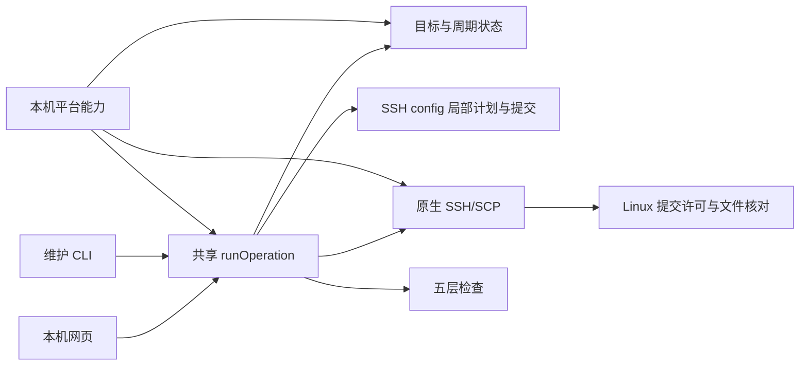

# 总体思路：让新 Linux 容器快速进入远程 Codex 工作状态

## 1. 用户真正需要什么

用户频繁更换云平台 Linux 容器，希望只提供本次 SSH 连接信息，就能完成 VS Code 连接、反向代理配置、远端设置核对、Codex 准备和检查。已有代理参数可以复用，每台新容器的身份、配置所有权和恢复依据必须独立。

Windows 上已经实现并局部实测的产品形态是：解压后从一个入口启动，打开本机网页，由终端里的 Node 进程执行工作流。Mac 需要实现相同体验，但入口、系统工具发现、文件权限、用户数据目录和遗留锁恢复必须重新验证。

“一键”表示入口统一、配置自动化，不表示绕过 SSH 主机身份检查、密码认证、官方账号登录或真实使用确认。用户此前授权助手代操作某个测试容器，不等于产品应保存密码，也不等于将来 Mac 上任意目标均已授权。

## 2. 两条必须分清的路径

### 配置控制路径

```text
本机网页 → 终端中的 Node 工作流 → 短期 SSH / SCP → Linux 检查与受控写入
                       ↓
                 本机偏好与恢复记录
```

网页负责输入、预览、选择、进度和结果。SSH 认证交给原生终端。短期检查连接清除转发并禁用连接复用，不能承担自己正在验证的正式代理流量。

### 正式代理流量路径

```text
Linux 中的 Codex app-server
      ↓ HTTP_PROXY / HTTPS_PROXY
Linux 127.0.0.1:<远端代理端口>
      ↓ VS Code Remote SSH 会话的 RemoteForward
Mac 127.0.0.1:<本机 HTTP 代理端口>
      ↓ 本机已有代理
目标 HTTPS 服务
```

重点是反向转发：把远端的回环监听转回本机代理。不是在浏览器开一个本地服务，也不是把 Linux 的端口简单转到 Mac 就完成代理。两个端口允许不同。两端入口均限定回环，本机代理只支持无认证 HTTP 代理；不默认接受 SOCKS、全局 TUN、需要账号的代理或公网监听。

工具退出后，正式流量由用户 VS Code 会话维持；完全关闭该会话可能释放转发，不能声称工具能后台保活。新窗口还可能有密码认证和配置重新加载。

## 3. 为什么保留外部轻量工具

业务瓶颈在 SSH、配置归属、取消恢复和真实验证，不在做一个复杂前端。现有网页是原生 HTML/CSS/JavaScript，本地 HTTP 与 CLI 共用 `runOperation`。无需为了 Mac 重写成另一套网页恢复逻辑，也无需立刻做 VS Code 插件。



Mac 端的建议是增加最小平台能力接缝，让系统工具、Code 定位、用户目录、权限与恢复进程核对在本机平台实现中分开。保持状态、配置计划、Linux 协议和工作流语义统一。是否保留单仓库双平台，由 Mac 本机调查后决定，不先建设通用插件框架。

## 4. 用户主流程

| 操作 | 意义 | 关键限制 |
| --- | --- | --- |
| initialize | 明确的新建或重建容器 | 创建新的目标身份，不按相同地址猜测原容器 |
| resume | 继续记录中的原容器 | 先核对真实配置与未完成写入，不能盲重放 |
| verify | 独立检查 | 不修改配置、不创建正式转发、不发模型请求 |
| remove | 移除代理配置 | 只移除工具拥有的增量，保留可用 SSH 连接 |
| abandon | 弃用旧容器记录 | 旧远端可不可达都能明确处理；不宣称远端已恢复 |

初始化顺序是：本机准备 → 输入与预览 → 基础 SSH 检查 → 连接与转发增量 → Remote SSH 准备 Server → 核对实际 Machine settings → 应用或复用两个代理字段 → 必要重连 → 商店安装/检查远端 Codex → 五层检查 → 官方界面真实请求及独立路径证据。

Server 由 VS Code Remote SSH 的官方路径准备；Codex 插件由用户从目标远端窗口的商店安装。工具不下载 VSIX，不自行实现插件安装或降级。不同网络主体的成功必须单独检查：本机 curl、Remote SSH 下载、远端扩展宿主和 Codex 后端不是同一条网络路径。

## 5. 状态为什么不能简化成一个 done

状态至少分四层：本机偏好、容器目标、代理周期、资源写入。

- 偏好保存本机代理、默认端口等非秘密信息；不携带某台旧容器的身份或恢复数据。
- `targetId` 表示用户明确选定的一次容器生命周期。地址和 alias 相同也可能是重建后的新容器。
- `cycleId` 表示同一目标一次代理配置周期。正常移除后重配创建新周期，保留旧周期基线。
- 连接、转发和远端 settings 各有资源状态、所有权、首次恢复依据与未完成写入意图。

`untouched`、`reused`、`applied`、`reverted`、`unknown` 具有不同意义。等价复用没有修改原文件，也不取得删除所有权。远端没触及和远端结果未知不能混为一谈。

写入前先保存意图与摘要；写后核对实际结果。取消时先结束或冻结原任务，再用独立、有界的恢复信号收尾；不能拿已取消的信号去做恢复。回执丢失不能直接判失败并重写，必须区分“未写”“已写”“第三种用户变化”“仍有写者”。详细契约见原 Spec 第 4、5、8 节。

## 6. 只修改什么

1. 本机受支持 SSH config 内独立连接块及带目标/周期标记的反向转发片段。
2. 实际 Linux VS Code Server 的 Machine settings 中 `http.useLocalProxyConfiguration=false` 与 `http.proxy=http://127.0.0.1:<远端端口>`。
3. 工具自己的受限偏好、状态与必要暂存。

保留注释、无关字段、BOM/换行和用户后续修改。摘要不一致时停止，不“帮忙修好整份配置”。不改 `.bashrc`、全局代理、Codex 登录文件、SSH 认证策略、服务器转发权限或自动更新偏好。

## 7. 如何证明成功

| 层次 | 证明什么 | 不能替代什么 |
| --- | --- | --- |
| 本机 HTTP 代理 | 代理可响应预期探测 | VS Code 已用它 |
| SSH | 本次目标可认证、远端工具可用 | 正式会话有转发 |
| 远端入口 | 正式回环监听存在且符合约束 | 目标服务 TLS 可达 |
| 目标 HTTPS | CONNECT/TLS/预期目标响应成立 | Codex 已登录且能回复 |
| Codex 进程 | 唯一可信后端身份、代理字段和绕过配置核对 | 某个模型请求实际使用代理 |
| 官方界面新回复 | 本次用户操作真的完成 | 请求的网络路径归因 |
| PID/socket 证据 | 指定进程在观察窗口新建到代理的连接 | 连接载荷或具体 HTTPS 目的地 |

五层自动检查、真实新回复、进程路径证据应分别记录。收到 401 可作为无凭证网络探测的预期结果，但不能称为模型使用成功。测试夹具与真实容器、Windows 与 Mac、旧版本与新候选均不可互相代替。

## 8. Mac 接手的最短合理路线

先在 Mac 上用原生终端做只读环境调查和认证探针，确认“页面等待 + 原生密码提示 + 取消”能成立，再接状态与写入。先复用现有深层模块，集中实现平台差异。每个可验证单元自查修复，尽量由开发者完成自动验证，把必要的人类登录或系统确认集中安排。

最终必须使用同一个 Mac 候选包走完：干净 A → 配置与请求 → A 不可达后的明确弃用 → 全新 B → 正常移除保留 SSH。不要在一台已配置好的容器上反复运行，就宣布完整首次安装和跨容器验收完成。
